

  

  
  
  
  

  

 


  


  

  <a href="https://www.Courlix.com"></a>
  <a href="https://github.com/AbdAllah-237/ai-automated-outreach-n8n"></a>
  <a href="https://github.com/AbdAllah-237?tab=repositories"></a>
  <a href="https://github.com/AbdAllah-237?tab=repositories"></a>
  <a href="https://github.com/AbdAllah-237?tab=repositories"></a>
  <a href="https://github.com/AbdAllah-237?tab=repositories"></a>

 

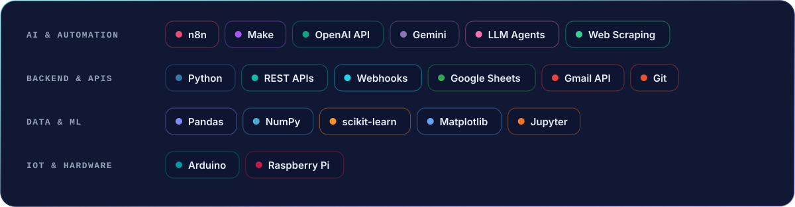

  

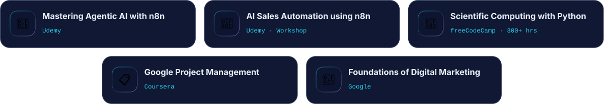

  

  
  
  
  

  <picture>
    <source media="(prefers-color-scheme: dark)" srcset="https://raw.githubusercontent.com/AbdAllah-237/AbdAllah-237/output/github-snake-dark.svg"/>
    <source media="(prefers-color-scheme: light)" srcset="https://raw.githubusercontent.com/AbdAllah-237/AbdAllah-237/output/github-snake.svg"/>
    
  </picture>

 

  <b>Got a repetitive process eating your team's time? Let's automate it.</b>  
  

